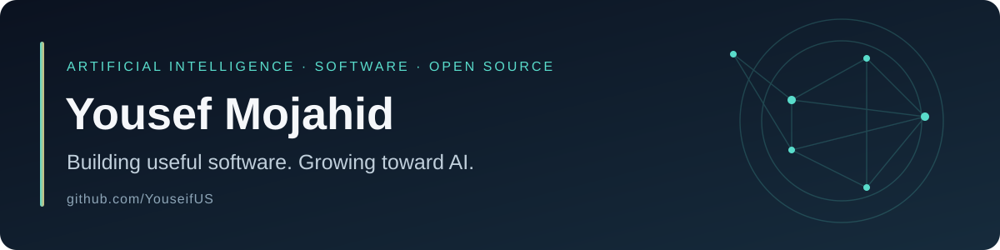

  

  <strong>Computer Science Student · AI Focus · Practical Software</strong>

  <a href="#selected-projects">Projects</a> ·
  <a href="#open-source">Open Source</a> ·
  <a href="https://github.com/YouseifUS?tab=repositories">All Repositories</a>

## About me

I'm **Yousef Mojahid**, a computer science student working toward a career in **artificial intelligence**. I learn by building, sharing my work, and improving it through real use.

My current projects turn everyday needs into focused mobile apps. I care about thoughtful interfaces, Arabic language support, privacy, and software that works offline.

## Current focus

- **AI foundations:** Python, problem solving, and the mathematics behind machine learning.
- **Building and shipping:** practical applications with usable releases and clear documentation.
- **Open source:** contributing fixes and learning from established codebases.

**Tools in my published apps:** TypeScript · React Native · Expo · Git & GitHub

## Selected projects

| | **Niyyah · نية** | **Azkar · أذكار** |
| :--- | :--- | :--- |
| **Purpose** | Connect daily habits to intention and personal meaning. | A quiet space for morning and evening remembrance. |
| **Highlights** | Arabic interface, offline habit tracking, daily progress, and local reminders. | Offline reading, repetition counters, light/dark themes, and prayer-time reminders. |
| **Built with** | React Native · Expo · TypeScript | React Native · TypeScript · Android |
| **Explore** | [Source](https://github.com/YouseifUS/mckinsey-forward-projects/tree/main/projects/intention) · [Android releases](https://github.com/YouseifUS/mckinsey-forward-projects/releases) | [Source](https://github.com/YouseifUS/azkar) · [Android releases](https://github.com/YouseifUS/azkar/releases) |

  
  &nbsp;&nbsp;&nbsp;
  

Niyyah · نية &nbsp; / &nbsp; Azkar · أذكار

## Open source

**[PdfCraft — Arabic text handling](https://github.com/storytold/pdfcraft/pull/1369)**  
Submitted a pull request to preserve Arabic text order when copying, searching, and editing PDFs, with regression coverage for mixed Arabic/English text, digits, and save/reopen behavior.

## Connect

Interested in AI, practical software, or Arabic-friendly tools? Explore my projects, open an issue, or start a discussion on a relevant repository.

Building steadily. Learning openly. Making useful things.

